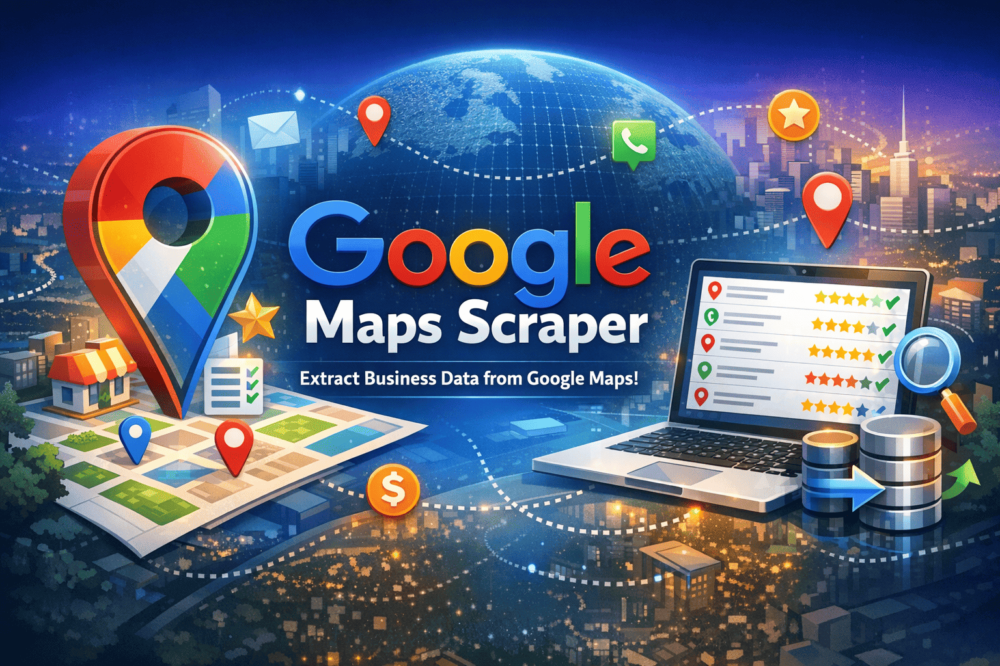
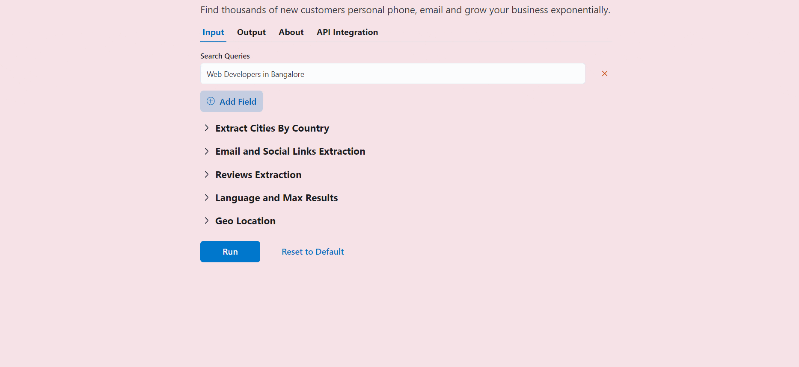
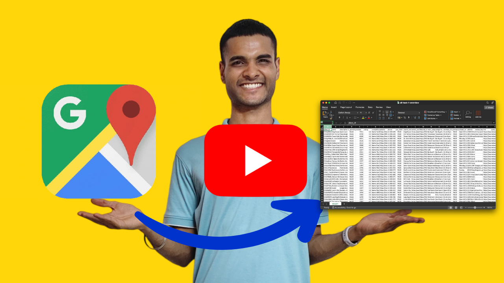
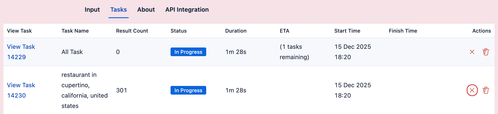
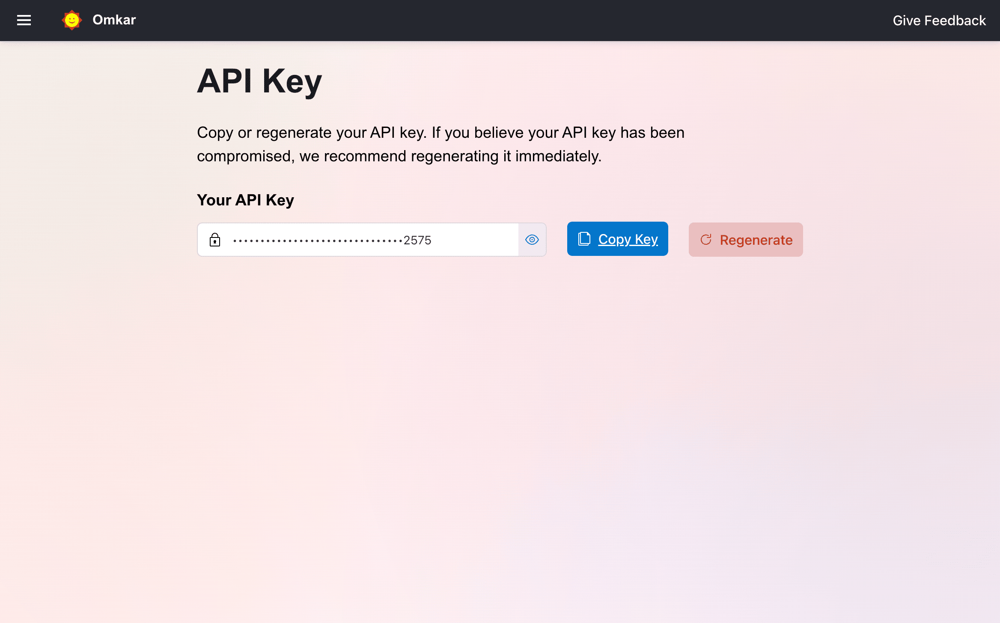
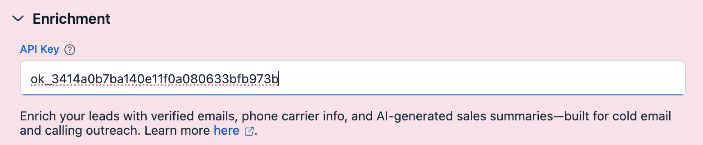
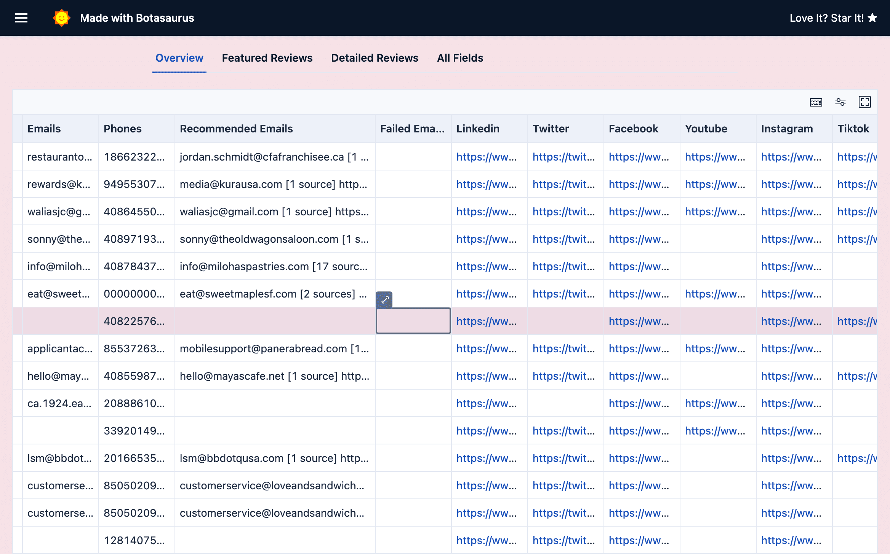
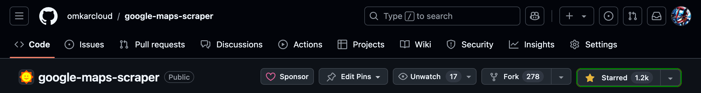

  <h1>Get the Google Maps Leads You Want — Without Breaking the Bank 🤖</h1>

  
  
  

  

---
Google Maps Extractor gets you the Google Maps leads you want — names, phones, websites, **emails** — without paying a fortune.

The most popular Google Maps Scraper on GitHub, with 3.6K+ stars.

  

<b>No credit card. 200 free searches a month</b>

## 🌍 Public data. 👿 High prices

You need customers. Google Maps has them.

You want the list. With emails. In bulk.

Apify and Outscraper charge a fortune 💸 for it. For data that costs them nothing.

That's wrong 😠.

<!-- SB7: GUIDE → PLAN → SUCCESS → CTA -->

Our Google Maps Extractor Desktop App gets you up to 100,000 Google Maps leads a month, free, so you can 🤝 reach your customers.

Without emptying your pockets 😎.

  

## ⚡ Why Choose Us Over Apify & Outscraper

Why you can trust us:

- **3.6K+ stars on GitHub** — the most popular Google Maps Scraper App on GitHub.
- **Rated Excellent — 4.7 from 37 reviews** on [Trustpilot](https://www.trustpilot.com/review/omkar.cloud).

- Our open source work is sponsored by **[1100+ developers on GitHub](https://github.com/sponsors/omkarcloud)**.

We're smaller than Apify and Outscraper, but we beat them where it matters:

- **More leads per city.** Same search, more businesses found.

- **80x more generous free plan than Apify.** Apify's $5 free credit gets you [~1,250 leads](https://apify.com/compass/crawler-google-places). We give you **200 free searches a month at ~500 leads each. That's 100,000 free leads every month.** Most users never pay.

What you get out of the box:

- **50+ data points**, extracted in real time.
- **Enrichment built in** — emails, social profiles, and decision-maker contacts.
- **Reviews extraction that actually works.**
- **Built-in API with 13 endpoints** for Python/Node.js integration.

## Results

Talk is cheap. Here's what I extracted with this tool:

- 🍔 **21,068 restaurants in New York City** — [Download csv and see results](https://www.omkar.cloud/l/restaurant-in-new-york-city)
- 💪 **14,253 gyms in London** — [Download csv and see results](https://www.omkar.cloud/l/gym-in-london)
- 🎂 **9,115 bakeries in Paris** — [Download csv and see results](https://www.omkar.cloud/l/bakery-in-paris)

44,000+ leads from just 3 searches, with 197 still left in the free plan 😎.

**Watch it in action.** See the tool pull 20,000+ real New York City leads and decide in minutes if it's worth your time.

## 3 steps to your first 100,000 leads

1. **Download the app.** 👉 [Download Google Maps Extractor](https://www.omkar.cloud/google-maps-extractor/download)

  

2. **Enter your search and press Run.** For example: "restaurants in New York City".
3. **Sit back and get your 20K New York City leads.**

## ❓ FAQs

## 🛑 How do I cancel a running search?

Click on the Abort Icon to abort the task.

**Note:**
- Aborting an All Task will abort its child tasks.

## 🔍 Which search strategy should I use?

Stick with the default **Detailed** strategy. It finds the most businesses and is only slightly slower than Fast.

| Strategy | Finds | Speed | Best for |
|---|---|---|---|
| **Detailed** (default) | The most businesses | Fast | Almost everything |
| **Fast** | About 4% fewer than Detailed | About 15% faster than Detailed | Very large runs, such as a **whole country** |
| **Fastest** | About the same as Fast | Slightly faster than Fast | **Whole-country** runs on computers with less than 8 GB RAM |
| **Zoom 15–18** | Similar to Detailed | Slow (hours for a big city) | Advanced users only |
| **Geolocation** | Only businesses inside your point or shape | Depends on area size | Searching a custom area instead of a city |

**Pro Tip:** Use **Filters for Faster Runs** to make searches 3–5x faster. The tool skips every business that doesn't match instead of collecting it. Try:

1. **Quick picks** → Operational only, Established (75+ reviews), Good rating (4★+), Has website (tech-savvy), Has phone
2. **Category In** → click **Suggest with AI** and it picks the right categories

## 💰 Pricing

Apify and Outscraper charge **per result**. We charge **per search**, and each search on average yields ~500 results. That's the cheapest per-lead cost in the market.

| Plan | Price | Searches | Who it's for |
|---|---|---|---|
| **Free** | $0 | 200/month | Your first 100,000 leads. No credit card needed. |
| **Starter** | $16/month | 5,000/month | Getting clients every month, city after city. |
| **Unlimited** | $48/month | Unlimited | Agencies and heavy users extracting country-level data. |

### Money Back Guarantee, Refund in 2 clicks

Cancel anytime. No questions asked.

1. Go to the [Transactions Page](https://www.omkar.cloud/billing/transaction-history).
2. Click **Request Refund**, then confirm.
3. Money is back in 1–2 business days. No emails, no explanations.

  

## ✨ Enrichment: Same Leads, Higher Conversion

Enrichment turns Google Maps business data into sales-ready contacts. Same leads, same effort, much higher conversion.

What you get for each business:

- **Best email for outreach**, verified for deliverability.
- **Social profiles** like LinkedIn and Twitter, so you know who you're pitching.
- **Phone type**: mobile or landline. Mobiles reach owners. Landlines reach receptionists.
- **Sales summary**: a personalized pitch for each business, so they see you did your research.

The website part (emails and social profiles from business websites) is open source. See [website-email-contact-scraper](https://github.com/omkarcloud/website-email-contact-scraper).

<!-- [PLACEHOLDER VIDEO: Enrichment demo — same leads, higher conversion] -->

### Set up enrichment

1. [Sign up](https://www.omkar.cloud/auth/sign-up) on Omkar Cloud.

2. Open the [API Key Page](https://www.omkar.cloud/api-key) and copy your key.

3. Paste the key in the app's **Enrichment** section.

<!--
4. Solve a one-time captcha on [this page](https://www.omkar.cloud/account/verify-phone). Click the captcha box, complete the puzzle, and you're verified in a few seconds. It keeps bots from draining the free credits.

-->

4. Run your search as usual.

That's it. Enriched fields appear in the **Overview** tab.

To get the most out of enrichment, read the [Enrichment Documentation](https://www.omkar.cloud/tools/business-enrichment/about).

### Enrichment pricing

Enrichment is billed in credits. **1 credit = 1 cent.** You get **100 free credits every month**, no credit card needed.

| Enrichment | What you get | Cost |
|---|---|---|
| **Social Links & Emails** | Emails and social profiles from the business website | 0.2 credits per business |
| **Email Recommendation (AI)** | The best email for outreach, not generic info@ addresses | Free |
| **Email Verification (MillionVerifier)** | 98%+ deliverability | 0.2 credits per email |
| **Email Verification (ZeroBounce)** | Highest-rated verifier on G2 | 1 credit per email |
| **Phone Carrier Info** | Landline or mobile, plus carrier name | 2 credits per business |
| **Place Sales Summary (AI)** | Business context from their listing, tailored to what you sell | 1 credit per business |

What that means for website emails, with AI recommendation included:

- **Free:** 100 credits → **500 website emails** a month.
- **Starter ($6):** 600 credits → 3,000 website emails.
- **Growth ($32):** 3,200 credits → 16,000 website emails.
- **Scale ($86):** 8,600 credits → 43,000 website emails.

To learn more, see the [Business Enrichment API](https://www.omkar.cloud/tools/business-enrichment).

## 📚 Learn More

### App Specific FAQs
- [Do I need to do anything else to use the tool effectively?](https://github.com/omkarcloud/google-maps-scraper/blob/master/advanced.md#do-i-need-to-do-anything-else-to-use-the-tool-effectively) [Very Very Important! MUST READ]
- [How to use the Geolocation feature?](https://github.com/omkarcloud/google-maps-scraper/blob/master/advanced.md#how-to-use-the-geolocation-feature)
- [How to create polygons and search using Geolocation?](https://github.com/omkarcloud/google-maps-scraper/blob/master/advanced.md#how-to-create-polygons-and-search-using-geolocation)
- [I want all businesses in a country. What's the best approach?](https://github.com/omkarcloud/google-maps-scraper/blob/master/advanced.md#i-want-all-businesses-in-a-country-whats-the-best-approach)
- [Are there any usage limits? (and 50+ data points)](https://github.com/omkarcloud/google-maps-scraper/blob/master/advanced.md#are-there-any-usage-limits)
- [How to get the Pro Version?](https://github.com/omkarcloud/google-maps-scraper/blob/master/advanced.md#how-to-get-the-pro-version)
- [How do I get a refund?](https://github.com/omkarcloud/google-maps-scraper/blob/master/advanced.md#how-do-i-get-a-refund)
- [How do I preserve non-English characters when exporting?](https://github.com/omkarcloud/google-maps-scraper/blob/master/advanced.md#how-do-i-preserve-non-english-characters-when-exporting)
- [On macOS, Chrome is not opening when I run the app. What should I do?](https://github.com/omkarcloud/google-maps-scraper/blob/master/advanced.md#on-macos-chrome-is-not-opening-when-i-run-the-app-what-should-i-do)
- [Why does the result count drop after a task completes?](https://github.com/omkarcloud/google-maps-scraper/blob/master/advanced.md#why-does-the-result-count-drop-after-a-task-completes)

### Developers FAQs
- [How can I run the extractor on AWS and GCP VMs?](https://github.com/omkarcloud/google-maps-scraper/blob/master/server-deployment.md)
- [How did you build this extractor?](https://github.com/omkarcloud/google-maps-scraper/blob/master/advanced.md#how-did-you-build-this-extractor)
- [Any other products that might be useful to me?](https://github.com/omkarcloud/google-maps-scraper/blob/master/advanced.md#any-other-products-that-might-be-useful-to-me)

### Services & About
- [Can you tell me about the Done For You service?](https://github.com/omkarcloud/google-maps-scraper/blob/master/advanced.md#can-you-tell-me-about-the-done-for-you-service)
- [Do you do custom big data projects?](https://github.com/omkarcloud/google-maps-scraper/blob/master/advanced.md#do-you-do-custom-big-data-projects)
- [I need a feature from another app. Can you add it?](https://github.com/omkarcloud/google-maps-scraper/blob/master/advanced.md#i-need-a-feature-from-another-app-can-you-add-it)
- [Tell me about Omkar Cloud](https://github.com/omkarcloud/google-maps-scraper/blob/master/advanced.md#tell-me-about-omkar-cloud)
- [Why should I use your product over bigger brands?](https://github.com/omkarcloud/google-maps-scraper/blob/master/advanced.md#why-should-i-use-your-product-over-bigger-brands)
- [What else can I use this tool for?](https://github.com/omkarcloud/google-maps-scraper/blob/master/advanced.md#what-else-can-i-use-this-tool-for)

## 💬 Have Questions? We have answers.

You're a buisness owner — we know how hard getting customers is. So we offer full support: just message us and we'll reply ✅ with a solution within 1 working day.

## Love It? [Star It ⭐!](https://github.com/omkarcloud/google-maps-scraper)

Star the repo ⭐ and become my star hero!

It's just 1 click, but it means the world to me.

## Your customers are on Google Maps. Go get them.

You've seen the maximum leads per search, the price, and the money-back guarantee. The only thing left is your first search.

  

Free forever plan. No credit card. Refund in 2 clicks if you change your mind.

